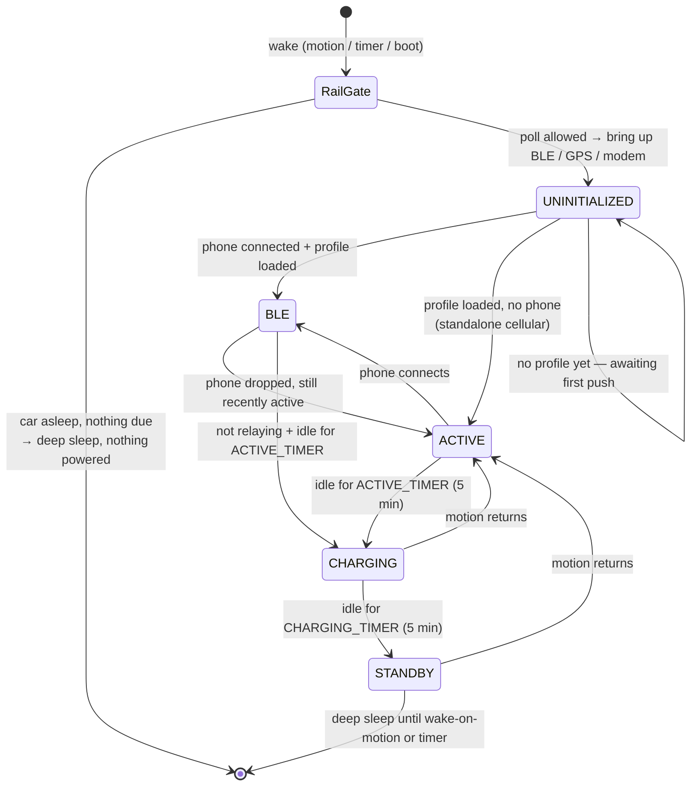

# ABRP OBD-Standalone Dongle

A standalone OBD-II telemetry dongle for [A Better Routeplanner](https://abetterrouteplanner.com/).
It reads a vehicle's EV data over OBD and pushes it to ABRP — **on its own over 4G/LTE, with no
phone required** — and additionally over BLE when the ABRP app is connected. Built on the
[Freematics ONE+](https://freematics.com/store/index.php?route=product/product&product_id=94)
(ESP32 + STM32 co-processor) on top of the Freematics Arduino libraries and sketches.

> **New here? Read [`DONGLE_CONTEXT.md`](DONGLE_CONTEXT.md) with an AI assistant.** It is the full
> context dump for this project — firmware *and* app. This README is the fast tour; that file is
> everything else.

---

## What it does

- **Cellular telemetry** — polls the car and uploads to ABRP over LTE-M, parked or driving, phone or no phone.
- **BLE telemetry** — when the ABRP app is connected, telemetry streams over Bluetooth and cellular stands down.
- **Flash logging** — every reading is written to an on-device CSV (LittleFS) as a black box.
- **BLE log retrieval** — the app pulls that CSV over Bluetooth (no USB, no unplugging the dongle).
- **BLE firmware update (OTA)** — signed images flashed from the app over Bluetooth, with rollback.
- **Deep-sleep power management** — a 12 V rail gate plus motion wake keep a parked car's battery safe.
- **Security stack** *(built, currently dialled to compatibility mode — see flags)* — link
  encryption, an HMAC access handshake, and RS256-signed vehicle profiles.
- **OBD-alarm awareness** *(built, currently note-only)* — records whether a car's OBD port is
  alarm-equipped; enforcement is bypassed pending fixes.

## Limits & things to know

- **One car per dongle.** The vehicle profile and push token are provisioned per dongle.
- **BLE telemetry is not MTU-aware.** `logData()` sends the frame without chunking, so on Android at
  the default 23-byte MTU a long frame gets truncated. Frames are kept short in practice; this is
  long-standing behaviour, not a regression.
- **The security features are staged, not all on.** In this checkout bonding, auth enforcement and
  profile-signature enforcement are **OFF** (compatibility with the current app); OTA signing is **ON**.
- **The OBD-alarm gate is bypassed** (`OBD_ALARM_ENFORCE 0`) after field testing found
  enforcement-breaking bugs — see [`DONGLE_CONTEXT.md`](DONGLE_CONTEXT.md) §7 (full autopsy in its
  Appendix J). The flag is still stored and shown in the app; the dongle just doesn't act on it.
- **The STM32 co-processor firmware is a closed vendor blob** — not in this repo and not modifiable.
  Everything here is ESP32-side.
- **Alarm-equipped OBD ports are a real hazard** on some cars (BMW i3 confirmed): transmitting on the
  bus while the car is locked sets off the anti-theft alarm. Passive presence is fine.

---

## Instructions manual

### Flashing

1. Install the [PlatformIO](https://platformio.org/install/ide?install=vscode) VS Code extension —
   you'll see the PlatformIO logo in the left toolbar.
2. Open the [`baseLogger`](baseLogger) folder; `platformio.ini` loads automatically.
3. Connect the dongle over USB.
4. Run **PlatformIO: Upload**, or **Upload and Monitor** to watch the serial log while it boots.

### First-time vehicle setup

The dongle needs a vehicle profile before it can poll anything useful. That profile is pushed from
the ABRP app the first time you connect the dongle and save it to a vehicle. It then persists to
flash and is restored on every wake — so after first setup the dongle works standalone, with no
phone. Until a profile is pushed the dongle has no PID list and no vehicle token, so it advertises on
BLE and does not poll or upload at all.

### Serial maintenance console (USB only — physical access by design)

Type these into the serial monitor at any time:

| Command | Does |
|---|---|
| `DUMP` | Stream the entire flash CSV log over serial |
| `STAT` | Log storage usage |
| `CLEAR` | Erase the flash log |
| `RADIO` | Dump the cellular modem configuration |
| `AT…` | Pass a raw AT command to the **cellular modem** |
| `BONDCLEAR` | Erase all BLE bonds (phones must also "forget" the device — see below) |
| `AUTHCLEAR` | Erase the auth secret — this is how you **revoke** a lost phone |
| `OTARESET` | Clear the OTA anti-downgrade floor (after a bench flash to a lower version) |
| `JWSTEST` | Self-test the profile-signature verifier |
| `RESUME` | Hand back to normal duty (re-allow sleep) after a maintenance session |

> **One-sided bonds bite.** If you clear bonds on the dongle (or reflash with bonding disabled), also
> "forget" the dongle in the phone's Bluetooth settings. A bond stored on one side only presents as a
> connection that drops with no error anywhere.

### Releasing a firmware update (OTA)

Signed firmware is distributed through a **private release repository**. The ABRP app fetches the
newest release from there and streams it to the dongle over BLE; the dongle verifies the ECDSA
signature before applying and rolls back if anything fails.

1. **Bump `OTA_FW_VERSION`** in `config.h` (mandatory — a stale version makes every dongle refuse
   the update as a downgrade).
2. Build with PlatformIO → `firmware.bin`.
3. Sign it: `tools/ota_sign.py` produces the signature with the private signing key (the matching
   public key is baked into the firmware in `Helpers/ota_pubkey.h`).
4. Upload **exactly two assets** to the repo's release: `firmware.bin` and `manifest.json`
   (version, size, sha256, signature, `sig_alg: ecdsa-p256-sha256`, description).
5. The app re-reads the manifest on every check, so the release is live immediately.

Access to the repo uses an access token that testers **enter manually in the app** — it is never
committed anywhere. If a token leaks, revoke it and mint a new one; dongles are unaffected either
way, because they trust the **signature**, not the repository.

---

## The files

### `baseLogger/` — the sketch

| File | What it is |
|---|---|
| `logger.ino` | Main sketch: `setup()` (runs on power-up/reset) and `loop()` (runs forever after). The poll cycle, wake gate, profile apply, upload and all service calls live here. |
| `config.h` | **Every macro and feature flag.** Start here to change behaviour. |
| `platformio.ini` | Build configuration (board, framework, build flags). |

### `baseLogger/Helpers/` — one concern per header, all `#include`d into the sketch

| File | What it does |
|---|---|
| `state_machine.h` | The activity state machine (BLE / ACTIVE / CHARGING / STANDBY) — diagram below. |
| `sleep_power.h` | Deep sleep, the IO36 12 V rail read, wake-cause decoding, wake-on-motion arming. |
| `mems.h` | ICM-42627 motion sensor: movement detection and wake-on-motion. |
| `icm42627_cal.h` | Accelerometer bias calibration and the WOM threshold. |
| `gps_location.h` | GNSS position, the parked-location average, the movement-streak logic. |
| `clock_sync.h` | Sets the RTC from GNSS / NITZ / NTP. |
| `telemetry_format.h` | Builds the ABRP telemetry frame (cellular body plus the trimmed BLE frame). |
| `network_upload.h` | Cellular upload, bulk POST, the offline backlog. |
| `ble.h` | The BLEWrapper instance, per-wake BLE bring-up/teardown, the persisted-profile loader, `bleRelaying()`. |
| `log_dump.h` | BLE log-retrieval protocol (ABD7). |
| `ota_update.h` | BLE firmware-update engine (ABD5/ABD6): staging, ECDSA verify, rollback, the ABD5 info JSON. |
| `ota_pubkey.h` | Embedded ECDSA public key for OTA image verification. |
| `auth_gate.h` | Access handshake (ABD8 nonce + HMAC) and the per-dongle secret. |
| `jws_verify.h` | RS256 JWS signature verification (mbedTLS) for signed profiles. |
| `profile_sig.h` | Receives and verifies a signed profile over ABD2, then applies it. |
| `alarm_gate.h` | OBD-alarm gate (currently bypassed): flag storage, permit logic, ABD5 publish. |
| `logging.h` | The serial maintenance console and the flash event log. |
| `misc.h` | Odds and ends, including the CAN-sniff diagnostic. |
| `dummy_test.h` | Test scaffolding. |

### `baseLogger/tools/` and `baseLogger/utils/`

| File | What it does |
|---|---|
| `tools/ota_keygen.py` | Generate the OTA signing keypair. |
| `tools/ota_sign.py` | Sign a firmware image for OTA. |
| `utils/serial_monitor.py`, `serial_to_file.py`, `file_to_serial.py` | Serial helpers (e.g. capturing a `DUMP` to a file). |

### `libraries/` — vendored dependencies

| Library | What it is |
|---|---|
| `FreematicsPlus` | Vendor library: co-processor link, OBD, GNSS, cellular. From [Freematics](https://github.com/stanleyhuangyc/Freematics/tree/master). |
| `BLEWrapper` | Our GATT service (ABD0) — all BLE communication with the ABRP app. |
| `OBDWrapper` | Wraps the vendor `COBD` class: polls the profile's PIDs and returns them as a vector. |
| `NetworkWrapper` | Abstract network class, implemented by `CellWrapper` and `WiFiWrapper`. |
| `DataLogger` | LittleFS CSV logging and segment rotation. |
| `ESP32Time`, `mathparser`, `nlohmann` | RTC, PID equation evaluation, JSON. |

---

## Config macros worth knowing (`baseLogger/config.h`)

`config.h` opens with a **CONFIGURATION MAP** comment block documenting the intended production
values — read that first. The load-bearing flags:

### Security & access — staged; this checkout is compatibility mode

| Macro | Now | Meaning |
|---|---|---|
| `BLE_ENABLE_BONDING` | `0` | `1` = LE Secure Connections (encrypted link) with gated attributes. `0` = plain link. |
| `AUTH_ENFORCE` | `0` | `1` = only an ABD8 HMAC proof grants a session. `0` = the legacy token grants it. |
| `PROFILE_REQUIRE_SIGNATURE` | `0` | `1` = profile values must arrive inside a verified JWS. `0` = raw packages accepted. |
| `OTA_REQUIRE_SIGNATURE` | `1` | Firmware images must be ECDSA-signed. Leave on. |
| `BLE_MAX_BONDS` | `10` | Soft cap under Bluedroid's hard limit of 15; pruned at BLE bring-up. |

> Those three `0`s make the dongle speak the **older, pre-security app protocol**. Set all three to
> `1` for the full locked stack — and re-pair, forgetting the dongle on the phone first. Any change
> here needs a reflash.

### OBD-alarm gate — note-only right now

| Macro | Now | Meaning |
|---|---|---|
| `OBD_ALARM_GATE` | `1` | Compiles the alarm-gate code in. |
| `OBD_ALARM_ENFORCE` | `0` | `1` = actually gate polling on a flagged car. `0` = the flag is bookkeeping only. |

### Power & battery — validated in the power review, change with care

| Macro | Now | Meaning |
|---|---|---|
| `ATRV_GATE_ENFORCE` | `1` | Never poll a car the rail gate says is asleep. |
| `RAIL_AWAKE_VOLTS` | `13.3` | Rail voltage above which the car counts as awake/charging. **Per-vehicle — measure it.** |
| `WAKE_PARKED_MINUTES` | `30` | Deep-sleep timer cadence while parked. |
| `WAKE_CHARGING_MINUTES` | `3` | Faster cadence while charging. |
| `MAX_AWAKE_MINUTES` | `60` | Hard backstop: force sleep after this even if something is holding it awake. |
| `ACTIVE_TIMER` / `CHARGING_TIMER` | 5 / 5 min | Inactivity leashes between state transitions. |
| `IO36_LOCKOUT_LOW` / `_HIGH` | 8.0 / 11.0 V | Weak-battery band: suppress all polling so a recoverable 12 V isn't pushed over the edge. |

### Developer-maintained — check before every release

| Macro | Now | Meaning |
|---|---|---|
| `OTA_FW_VERSION` | `7` | **Bump every release.** A stale value makes OTA abort as "dongle already runs newer firmware". |
| `API_KEY` | — | Identifies the integration to the ABRP API. Ships in every image by design; useless without a per-vehicle token. |
| `ENABLE_CELL` / `ENABLE_WIFI` | `1` / `0` | Transport select. This is the cellular build. |
| `ENABLE_BLE`, `ENABLE_GPS`, `ENABLE_MEMS`, `ENABLE_LOGGING`, `ENABLE_SLEEP`, `ENABLE_OTA` | `1` | Feature toggles; each should degrade gracefully when off. |

### Diagnostics — keep all `0` in normal use

`PRINT`, `PRINT_MEMS`, `FAKE_DATA`, `FILE_TEST`, `NETWORK_TEST`, `ENABLE_CAN_SNIFF`,
`CAN_SNIFF_JOIN_PROBE`, `BLE_FORCE_REPUSH` (this last one forces a full clean + push + ATZ on
*every* reconnect instead of the fast path).

---

## Activity state machine

Every wake puts the dongle into one activity state. Movement, the 12 V rail and a live BLE session
decide which one — and when to go back to deep sleep.

**The rail gate comes first, before anything is powered.** Reading the OBD pin-16 voltage is a local
measurement — no bus traffic — so the dongle can tell whether the car is awake *without* poking it.
If the car is asleep and no reading is due, it goes straight back to sleep having powered no modem,
no GPS and no BLE: the cheapest possible skip.

**Then it polls on cadence and uploads.** Inactivity walks it down `ACTIVE → CHARGING → STANDBY →
deep sleep`; motion or a phone walks it back up. A live, *relaying* phone (connected **and**
authenticated) holds the leash so an app session isn't cut off mid-use — bounded by the
`MAX_AWAKE_MINUTES` backstop. A parked, charging car gets short one-shot pokes between sleeps rather
than being held awake, so the car's own ECUs are never kept alive by us.

---

## Good to know / conclusion

- **Two data paths, never both.** Phone present and relaying ⇒ BLE. Otherwise ⇒ cellular. A short
  grace after a phone drops keeps the two from racing (a live TLS POST and a live BLE link compete
  for CPU and contiguous heap, and running both used to drop the link).
- **A pushed profile persists.** It survives sleep and reboot and drives standalone cellular wakes
  too, so the dongle is not dependent on a phone after first setup.
- **Battery safety is the top constraint.** Most of the power logic exists so the dongle can never
  flatten a parked car's 12 V battery. Drain is governed by how often you poke the car, not by how
  long the ESP32 is awake — which is why the cadences and the rail gate matter more than raw sleep
  current.
- **`RAIL_AWAKE_VOLTS` is per-vehicle** and the bands are tight. Measure a new car's rail while
  driving and while switched off and locked before trusting anything that keys on it.
- **Security and alarm features are built and staged behind flags**, currently set for compatibility
  with the app in use. Reasoning, field findings and re-enable checklists live in
  [`DONGLE_CONTEXT.md`](DONGLE_CONTEXT.md) — including the full source documents embedded in its Part II.
- **When in doubt, read [`DONGLE_CONTEXT.md`](DONGLE_CONTEXT.md) with an AI assistant.** It carries
  the deep history, the protocol details and the hard-won gotchas that this README deliberately
  leaves out.

## License

Copyright 2024-2026 Iternio AB. Licensed under the [Apache License 2.0](LICENSE); see also
[`NOTICE`](NOTICE). Vendored and linked third-party code keeps its own licence; see
[`THIRD_PARTY_NOTICES.md`](THIRD_PARTY_NOTICES.md).

The license covers the code, not the names: Apache-2.0 grants no rights to "ABRP", "A Better
Routeplanner" or "Iternio" (section 6), so forks must not use them to name or brand their builds.
