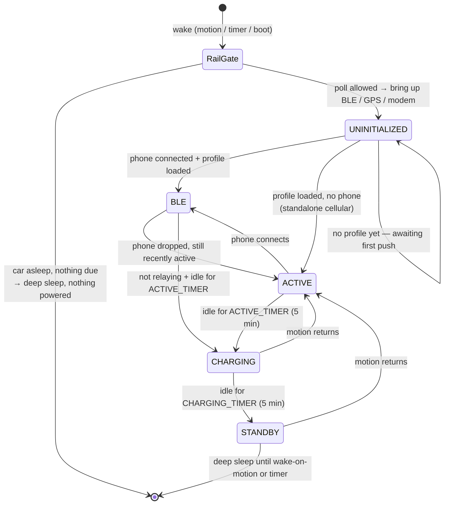

# Technical overview

How the dongle works inside, where the code lives and which settings matter. For setting a dongle
up, see the [Getting started guide](getting-started.md). For the design history, protocol details
and field findings behind all of this, see [`DONGLE_CONTEXT.md`](../DONGLE_CONTEXT.md).

## Architecture

The hardware is a [Freematics ONE+](https://freematics.com/store/index.php?route=product/product&product_id=94):
an **ESP32** running this firmware, a **SIM7070** LTE-M modem, GNSS, a motion sensor, and an **STM32
co-processor** that owns the vehicle interface (CAN, K-line and the OBD pin-16 voltage). The STM32
firmware is a closed vendor blob: it is not in this repo and cannot be changed. We drive it with
ELM327-style AT commands, and it implements only part of that command set. That limit decides which
cars can work; see [Vehicle support](#vehicle-support).

The dongle is **not a phone accessory**. It polls the car over OBD and uploads to ABRP over its own
modem, so a parked car keeps reporting with no phone nearby. A phone is an occasional privileged
client. Two consequences drive most of the design: a client that can write to the dongle can write
to the **car**, and nobody is standing next to a car whose 12 V battery is being flattened.

### Features

- **Cellular telemetry.** Polls the car and uploads to ABRP over LTE-M, parked or driving.
  Uploads are gzipped v2 `InputPointList` bodies to `/2/app/tlm`, with an offline backlog in flash.
- **BLE telemetry.** When the ABRP app is connected and authenticated, telemetry streams over
  Bluetooth and cellular stands down.
- **Flash logging.** Every reading and event is written to an on-device CSV (LittleFS) as a black box.
- **BLE log retrieval.** The app pulls that log over Bluetooth, with no USB and no unplugging.
- **BLE firmware update (OTA).** ECDSA-signed images flashed from the app, with trial boot and
  rollback.
- **Deep-sleep power management.** A 12 V rail gate plus motion wake keep a parked car's battery safe.
- **Security stack** *(see [Security](#security-and-access))*. An encrypted, bonded link and an
  HMAC access handshake (both on), and RS256-signed vehicle profiles (built, not yet required).
- **OBD-alarm gate** *(per vehicle)*. On a car flagged as alarm-equipped, bus traffic is rationed to
  driving and setup so the dongle never transmits on a locked, armed car.

### Two data paths, never both

Phone present and relaying (connected **and** authenticated) ⇒ BLE. Otherwise ⇒ cellular. A short
grace after a phone drops keeps the two from racing: a live TLS POST and a live BLE link compete for
CPU and contiguous heap, and running both used to drop the link.

### Vehicle profiles

The dongle carries **no vehicle profile and no token of its own.** The app fetches the profile for
the car's model from the ABRP backend (the PID list, the CAN commands and the equations that turn
replies into values) and pushes it, together with the vehicle's telemetry token, over BLE. The
dongle persists both to `/vehicle_profile.json` and restores them on every wake. Until a profile
arrives it advertises on BLE and does nothing else.

So a new car is supported by adding its profile **on the backend**, not by reflashing. The one thing
a profile cannot add is a new telemetry key: BLE forwards every key, but the cellular upload drops one
until `bulkStringV2` maps it to a v2 field.

## Vehicle support

The user-facing list of cars is in the [README](../README.md#will-it-work-with-my-car). This is why,
by backend profile (checked against all 50 in `abrp/obd` as of 2026-09-24):

| Profile | Status | Why |
|---|---|---|
| `i3`, `ix3`, `ix60`, `i3_test` | Does not work | Extended addressing (`ATCEA`), protocol B (`ATSPB`), flow control carrying the address byte |
| `eGolf`, `MEB_new` | Does not work | Hand-built raw frames, which need `ATCAF0`. `MEB` and `MEB_audi` read the same values without it |
| Mazda MX-30 | Uncertain | Flow control goes out on `72B`, not the request ID; depends on which ID the co-processor picks |

21 profiles set `ATFCSH`, which the co-processor ignores. They work only if its default
flow-control ID matches. The Renault Scenic (29-bit) has field evidence; the 11-bit profiles do not.
The full command-support table is in `DONGLE_CONTEXT.md` §6b.

**Alarm-equipped OBD ports** are a real hazard on some cars (BMW i3 confirmed): transmitting on the
bus while the car is locked sets off the anti-theft alarm. Passive presence is fine. The alarm gate
handles this per vehicle; see [OBD-alarm gate](#obd-alarm-gate--per-vehicle).

## Activity state machine

Every wake puts the dongle into one activity state. Movement, the 12 V rail and a live BLE session
decide which one, and when to go back to deep sleep.



**The rail gate comes first, before anything is powered.** Reading the OBD pin-16 voltage is a local
measurement with no bus traffic, so the dongle can tell whether the car is awake *without* poking it.
If the car is asleep and no reading is due, it goes straight back to sleep having powered no modem,
no GPS and no BLE.

**Then it polls on cadence and uploads.** Inactivity walks it down `ACTIVE → CHARGING → STANDBY →
deep sleep`; motion or a phone walks it back up. A relaying phone holds the leash so an app session
isn't cut off mid-use, bounded by the `MAX_AWAKE_MINUTES` backstop. A parked, charging car gets short
one-shot pokes between sleeps rather than being held awake, so the car's own ECUs are never kept
alive by us.

**Battery safety is the top constraint.** Drain is governed by how often you poke the car, not by how
long the ESP32 is awake, which is why the cadences and the rail gate matter more than raw sleep
current.

**Deep sleep is a reboot, not a resume.** RAM is wiped and `setup()` runs again from the top.
Anything that must survive is `RTC_DATA_ATTR` or LittleFS.

## Code layout

### `baseLogger/` — the sketch

| File | What it is |
|---|---|
| `logger.ino` | Main sketch. `setup()` is the wake ladder; `loop()` is the poll and upload cycle. The wake gate, profile apply and all service calls live here. |
| `config.h` | **Every tunable and feature flag**, each with its reasoning. Start here to change behaviour. |
| `platformio.ini` | Build configuration (board, framework, build flags). |

### `baseLogger/Helpers/` — one concern per header

These are **not separate translation units**: they are `#include`d into `logger.ino` in dependency
order and share its globals. See [`AGENTS.md`](../AGENTS.md) before adding one.

| File | What it does |
|---|---|
| `state_machine.h` | The activity state machine (BLE / ACTIVE / CHARGING / STANDBY). |
| `sleep_power.h` | Deep sleep (the one `enterDeepSleep` primitive), the IO36 12 V rail read, wake-cause decoding, wake-on-motion arming. |
| `mems.h` | ICM-42627 motion sensor: movement detection and wake-on-motion. |
| `icm42627_cal.h` | Accelerometer bias calibration and the WOM threshold. |
| `gps_location.h` | GNSS position, the parked-location average, the movement-streak logic. |
| `clock_sync.h` | Sets the RTC from GNSS / NITZ / NTP / the HTTP `Date` header, and on each wake removes the drift deep sleep added, at a rate learned from NITZ/NTP resyncs. |
| `telemetry_format.h` | Builds the ABRP telemetry frame (cellular body plus the trimmed BLE frame). |
| `network_upload.h` | Cellular upload, bulk POST, the offline backlog. |
| `gzip_body.h` | gzip for the POST body, using the ESP32 boot ROM's deflate. |
| `geo_backlog.h` | Keeps location provenance in the backlog so stale positions are never uploaded as fresh. |
| `ble.h` | The BLEWrapper instance, per-wake BLE bring-up/teardown, the persisted-profile loader, `bleRelaying()`. |
| `log_dump.h` | BLE log-retrieval protocol (ABD7). |
| `ota_update.h` | BLE firmware-update engine (ABD5/ABD6): staging, ECDSA verify, rollback, the ABD5 info JSON. |
| `ota_pubkey.h` | Embedded ECDSA public key for OTA image verification. |
| `server_roots.h` | The root CAs the modem verifies the upload server against (generated). |
| `auth_gate.h` | Access handshake (ABD8 nonce + HMAC) and the per-dongle secret. |
| `auth_kex.h` | ECDH key agreement for provisioning that secret. |
| `jws_verify.h` | RS256 JWS signature verification (mbedTLS) for signed profiles. |
| `profile_sig.h` | Receives and verifies a signed profile over ABD2, then applies it. |
| `alarm_gate.h` | OBD-alarm gate (per vehicle): flag storage, permit logic, ABD5 publish. |
| `logging.h` | The serial maintenance console and the flash event log. |
| `misc.h` | Odds and ends, including the CAN-sniff diagnostic. |
| `dummy_test.h` | Test scaffolding. |

### `baseLogger/tools/` and `baseLogger/utils/`

| File | What it does |
|---|---|
| `tools/ota_keygen.py` | Generate a local OTA signing keypair, or write `ota_pubkey.h` from the KMS key (`--from-kms`). |
| `tools/ota_sign.py` | Sign a firmware image for OTA (KMS in the release workflow, or a local PEM). |
| `tools/server_roots.py` | Write `server_roots.h` from root CA PEMs. |
| `tools/fw_version.py`, `tools/pio_version.py` | Release version naming and its injection into the build; also the `factory` target, a single merged image for esptool on a blank unit. |
| `utils/serial_monitor.py`, `serial_to_file.py`, `file_to_serial.py`, `USB_Serial_Dump.py` | Serial helpers (e.g. capturing a `DUMP` to a file). |

### `libraries/` — vendored dependencies

| Library | What it is |
|---|---|
| `FreematicsPlus` | Vendor library: co-processor link, OBD, GNSS, cellular. From [Freematics](https://github.com/stanleyhuangyc/Freematics/tree/master). |
| `BLEWrapper` | Our GATT service (ABD0): all BLE communication with the ABRP app. |
| `OBDWrapper` | Wraps the vendor `COBD` class: polls the profile's PIDs and returns them as a vector. |
| `NetworkWrapper` | Abstract network class, implemented by `CellWrapper` and `WiFiWrapper`. The modem's network mode and LTE-M band list are set in `cellwrapper.cpp`. |
| `DataLogger` | LittleFS CSV logging and segment rotation. |
| `ESP32Time`, `mathparser`, `nlohmann` | RTC, PID equation evaluation, JSON. |

### `tests/` — host checks

Host-compiled checks for GPS parsing, telemetry, upload/AT parsing, gzip, clock range, log
diagnostics and the release tooling. They use the real firmware sources with fake transports; they
do not replace a run on a real dongle. How to run each is in [`AGENTS.md`](../AGENTS.md#testing).

## Building

```sh
cd baseLogger && pio run -e esp32dev
```

Flash and watch with `pio run -e esp32dev -t upload -t monitor` (115200 baud). `OTA_FW_VERSION` and
`FW_BUILD_TAG` come from the newest `vX.Y.Z` tag at build time, so fetch tags first; they are never
edited by hand. A clean build prints two pre-existing `"PRINT" redefined` warnings.

## Settings worth knowing

All in `baseLogger/config.h`, which opens with a **CONFIGURATION MAP** block documenting the
intended production values. Any change needs a reflash.

### Connectivity

| Setting | Now | Meaning |
|---|---|---|
| `CELL_APN` | `"hologram"` | The SIM provider's APN. |
| `ENABLE_CELL` / `ENABLE_WIFI` | `1` / `0` | Transport select. This is the cellular build. |
| `CATM_BANDS` (in `cellwrapper.cpp`) | `1,3,8,20,28` | LTE-M bands the modem scans: the European set. |

`cellwrapper.cpp` also sets the modem to GSM+LTE (`CNMP=51`) with LTE-M only on the LTE side
(`CMNB=1`). All three are written once and persist in the modem's NVM, so a matching value is never
rewritten. Release images are built with these defaults: a dongle running a custom APN or band list
must be updated over USB, because an OTA release would put the defaults back.

### Security and access

| Setting | Now | Meaning |
|---|---|---|
| `BLE_ENABLE_BONDING` | `1` | LE Secure Connections: every value and CCCD needs an encrypted link, so an unpaired phone can read and write nothing. Pairing is Just Works, so any phone can pair; the ABD8 handshake decides who gets a session. Flipping it needs every paired phone to forget the dongle first. |
| `PROFILE_REQUIRE_SIGNATURE` | `0` | `1` = profile values must arrive inside a verified JWS. `0` = raw packages accepted too. |
| `OTA_REQUIRE_SIGNATURE` | `1` | Firmware images must be ECDSA-signed. Leave on. |
| `BLE_MAX_BONDS` | `10` | Soft cap under Bluedroid's hard limit of 15; pruned at BLE bring-up. |

The ABD8 HMAC handshake is **unconditional**: it is the only thing that grants a session, and there
is no flag for it. `PROFILE_REQUIRE_SIGNATURE` stays `0` until the signed-profile path has been seen
succeeding in the field.

### Cellular TLS trust

Cellular uploads go only to a server whose certificate chains to one of the roots bundled in
`Helpers/server_roots.h`; without a verified chain nothing is sent and the frames stay in the backlog.
The bench WiFi build (`ENABLE_WIFI`, off) does not verify the server. A server move to a CA outside the
bundle needs firmware trusting the new root first. A dongle that stopped uploading because of a CA
change logs an `UPLOAD open trace untrusted` line per boot (see `DUMP`) and recovers with a firmware
update over BLE. The root list, the CA-change procedure and the modem's limits: `DONGLE_CONTEXT.md` §6a.

### OBD-alarm gate — per vehicle

| Setting | Now | Meaning |
|---|---|---|
| `OBD_ALARM_GATE` | `1` | Compiles the alarm-gate code in. |
| `ALARM_SETUP_PERMIT_MINUTES` | `10` | How long a completed profile push keeps a flagged car pollable for the setup wizard. |

Enforcement is per vehicle: the app's toggle writes `obd_alarm` over ABD2 into NVS, and an unflagged
car behaves exactly as if the gate weren't there. A flagged car is polled only while driving or
during setup, and parked charge sampling is suppressed. The remaining limits for flagged cars
(radio silence on suppressed timer wakes, the per-vehicle rail margin) are in `DONGLE_CONTEXT.md`
§7 and Appendix J.

### Power and battery — validated in the power review, change with care

| Setting | Now | Meaning |
|---|---|---|
| `ATRV_GATE_ENFORCE` | `1` | Never poll a car the rail gate says is asleep. |
| `RAIL_AWAKE_VOLTS` | `13.3` | Rail voltage above which the car counts as awake/charging. **Per-vehicle — measure it.** |
| `WAKE_PARKED_MINUTES` | `30` | Deep-sleep timer cadence while parked. |
| `WAKE_CHARGING_MINUTES` / `WAKE_DC_CHARGING_MINUTES` | `3` / `1` | Faster cadence while AC / DC charging. |
| `MAX_AWAKE_MINUTES` | `60` | Hard backstop: force sleep after this even if something is holding it awake. |
| `ACTIVE_TIMER` / `CHARGING_TIMER` | 5 / 5 min | Inactivity leashes between state transitions. |
| `CHARGE_END_POLL_FLOOR` | `12.2` V | After a charge, a rail between this and 13.0 V gets one final read, so the charge end and final SoC reach ABRP. |
| `CHARGE_STREAM_CONFIRM_SECONDS` / `CHARGE_DISCHARGE_AMPS` | `180` s / `2.0` A | While awake and polling continuously, a charging reading counts only after this long without a discharge sample, so regen at the start of a drive is not reported as charging. |
| `CHARGE_SILENT_HOLD_POLLS` | `4` | Polls the car doesn't answer that keep the charging latch, so the end of a charge is still read when the rail drops. With the rail high, silence never releases the latch. After this many polls it waits at the parked cadence instead. |
| `CHARGE_STALE_RESET_MINUTES` | `360` min | How long a held or paused charge keeps its fast-cadence budget, cap and corroboration after the last charge evidence, so a stuck current can't get a fresh budget at every silence. |
| `POST_DRIVE_WINDOW_MINUTES` / `POST_DRIVE_MAX_POLLS` | `15` min / `5` | After a drive ends with the rail high, a rail-high wake the car doesn't answer comes back in 3 minutes instead of 30. This lasts for this long after the last motion and is capped at this many polls, so a fast charge started right after parking is caught. |
| `PARK_RELOCATE_MIN_M` / `_MAX_HDOP` / `_MAX_SPREAD_M` | `500` m / `250` (HDOP 2.5) / `50` m | A parked car whose average of fresh, good (HDOP ≤ 2.5), tightly clustered (within 50 m) stationary GNSS fixes lies this far from its frozen spot, or has no frozen spot yet, is moved there: for a drive the GNSS never saw moving, or a cold boot. |
| `GPS_JUMP_MARGIN_M` / `GPS_JUMP_MAX_MPS` (in `FreematicsPlus.cpp`) | `2000` m / `70` m/s | A new GNSS fix is accepted within this margin plus this speed times the seconds since the last new fix; three consistent fresh fixes outside it, at most 60 s apart, replace a bad anchor. |
| `IO36_LOCKOUT_LOW` / `_HIGH` | 8.0 / 11.0 V | Weak-battery band: suppress all polling so a recoverable 12 V isn't pushed over the edge. |

`RAIL_AWAKE_VOLTS` was calibrated on one car with almost no margin: driving 13.25–15.2 V,
switched off 12.5–13.2 V. Measure a new car's rail while driving and while switched off and locked
before trusting anything that keys on it.

### Developer-maintained — check before every release

| Setting | Now | Meaning |
|---|---|---|
| `OTA_FW_VERSION` | from the tag | Injected at build time from the release version ([`RELEASING.md`](../RELEASING.md)). |
| `API_KEY` | — | Identifies the integration to the ABRP API. Ships in every image by design; useless without a per-vehicle token. |
| `ENABLE_BLE`, `ENABLE_GPS`, `ENABLE_MEMS`, `ENABLE_LOGGING`, `ENABLE_SLEEP`, `ENABLE_OTA` | `1` | Feature toggles; each should degrade gracefully when off. |

### Diagnostics — keep all `0` in normal use

`PRINT`, `PRINT_MEMS`, `FAKE_DATA`, `FILE_TEST`, `NETWORK_TEST`, `ENABLE_CAN_SNIFF`,
`CAN_SNIFF_JOIN_PROBE`, `BLE_FORCE_REPUSH` (this last one forces a full clean + push + ATZ on
*every* reconnect instead of the fast path).

## Serial maintenance console

USB only: physical access by design. Type these into the serial monitor (115200 baud) at any time.

| Command | Does |
|---|---|
| `DUMP` | Stream the entire flash log over serial (about 2.7 MB, roughly 4 minutes). Each segment starts with an `FW build=…` line naming the firmware that wrote it. |
| `DUMP n` | Stream only the newest `n` log segments (about 256 KB each, roughly 25 s apiece); `DUMP 3` usually covers the last drive. |
| `STAT` | Log storage usage. |
| `CLEAR` | Erase the flash log. |
| `RADIO` | Dump the cellular modem's persisted radio configuration. |
| `AT…` | Pass a raw AT command to the **cellular modem**. |
| `CLKPROBE` | Check RTC drift and whether an HTTP `Date` header is reachable (blocks ~30–60 s). |
| `TLSCHECK` | Open a fresh verified TLS session to the server (no data sent) and log the result. |
| `BONDCLEAR` | Erase all BLE bonds. Phones must also "forget" the dongle. |
| `AUTHCLEAR` | Erase the auth secret, revoking every phone. The next phone to connect provisions a new one. |
| `OTARESET` | Clear the OTA anti-downgrade floor (after a bench flash to a lower version). |
| `JWSTEST` | Self-test the profile-signature verifier. |
| `RESUME` | Hand back to normal duty (re-allow sleep) after a maintenance session. |

> **One-sided bonds bite.** If you clear bonds on the dongle (or reflash with bonding disabled), also
> "forget" the dongle in the phone's Bluetooth settings. A bond stored on one side only presents as a
> connection that drops with no error anywhere.

## Security and access

The stack has three layers: **pair** (LE Secure Connections, so a bystander can't read the
traffic), **prove** (ABD8 nonce + HMAC with a per-dongle secret, so only a permitted client gets a
session) and **sign** (RS256 JWS on vehicle profiles, ECDSA-P256 on firmware). Pairing, the handshake
and firmware signing are on; only signed profiles are not yet required.

The secret is provisioned trust-on-first-use by ECDH (`auth_kex.h`): the first phone to complete
setup owns the dongle, and the secret lives only on that phone. Until then there is no window: any
phone in range can claim an unprovisioned dongle, including one just cleared with `AUTHCLEAR`. It
can be reset over BLE within five minutes of a power-on (an unplug and replug, so it needs physical
access), or with `AUTHCLEAR` over serial. Design and phase history are in `DONGLE_CONTEXT.md` §3 and
Appendix A.

## Releases and OTA

Releases are cut by the manual **Release** workflow: it takes the version from the Conventional
Commits, builds, signs in AWS KMS and publishes a release. Only `feat`, `fix`, `perf`, `revert` and
breaking changes appear in the release notes and bump the version; `docs`, `ci`, `chore`, `test` and
`refactor` don't. See [`RELEASING.md`](../RELEASING.md).

The ABRP app fetches the newest signed release and streams it to the dongle over BLE; the dongle
verifies the ECDSA signature before applying and rolls back if the new image fails its health check.
The app currently reads releases from a private release repository, using an access token testers
enter in the app's developer tools. Dongles trust the **signature**, not the repository, so a leaked
token is a distribution problem, never a way onto a dongle: revoke it and mint a new one.

Each release also carries `factory.bin` (bootloader, partitions and app in one image for
`esptool.py write_flash 0x0`), which erases NVS and is meant for a blank unit.

## Known limits

- **The modem checks the server's certificate chain, not its name or dates.** Anyone who can redirect
  the dongle's DNS or traffic - including a fake 2G base station, since the modem is allowed to fall
  back to GSM - can present a free AWS certificate for their own domain and read the uploaded
  positions and battery data. Expired certificates are accepted too. The SIM7070 has no option to check
  the name. Uploads are signed with the vehicle token (HMAC, RFC 9421) instead of carrying it, so the
  token itself never crosses the cellular link; it still reaches the dongle over BLE at pairing.
- **One car per dongle.** The vehicle profile and token are provisioned per dongle.
- **BLE telemetry notifies one packet.** The ABD1 notify is fitted to the negotiated MTU−3 and drops
  low-priority fields when the frame is longer (temperature bounds first at iOS's ~185); at Android's
  default 23 it carries almost nothing. The readable value is always the full frame.
- **The co-processor is fixed.** Cars that need commands it doesn't implement cannot be supported by
  any change in this repo.
- **The SIM7070 caps a request body at 1024 bytes.** Gzip fits about 21 points in that, and a POST
  carries at most 12 (`MAX_FRAMES_PER_POST`).
